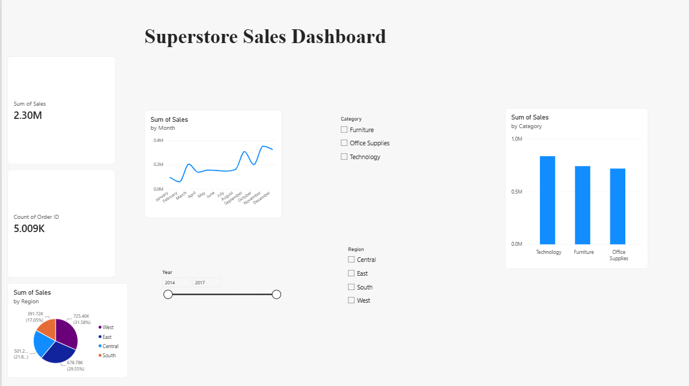

# Superstore Sales Dashboard

Interactive Power BI dashboard analyzing Superstore sales data.

## Tools
Power BI Desktop, Power Query

## Key Metrics
- Total Sales: 2.30M
- Total Orders: 5,009

## Features
- KPI cards (Sales, Orders)
- Sales by Category, Month, and Region
- Slicers for Region, Category, and Year

## Key Insights
- Technology is the top-selling category
- West is the top region (31.6% of sales)
- South is the lowest-selling region (17% of sales)
- November is the peak sales month

## Dashboard Preview

